# Tuned

A fast, simple IPTV player for Android TV and Fire TV. Sign in with Xtream Codes (or add an M3U playlist) and you're watching in two button presses. 4K HDR plays as HDR, and the TV switches to the right refresh rate for each channel.

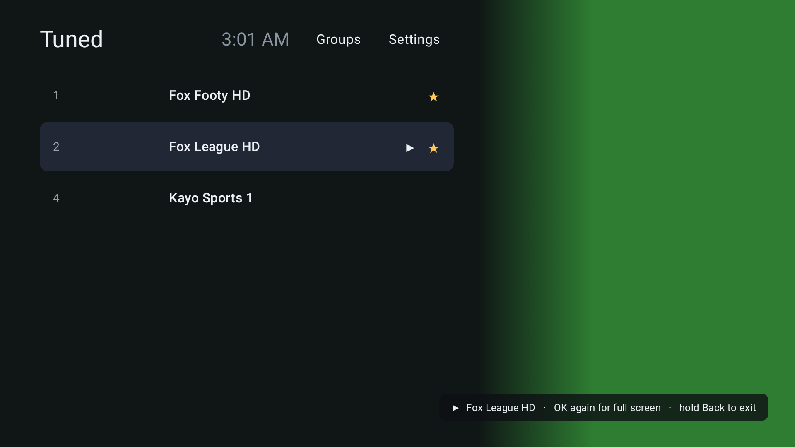

> Tuned is only a player. It ships with no channels. Use it with a service you're entitled to watch.

---

## 1. Download

There's **one APK for every device below**: the same file works on all of them.

**[⬇ Download the latest APK](https://raw.githubusercontent.com/andrewf13/Tuned/main/releases/tuned-latest.apk)** (10 MB, Android 6.0 or newer). Current version **1.0.0** · SHA-256 in [`releases/tuned-1.0.0.apk.sha256`](releases/tuned-1.0.0.apk.sha256)

**Link to type into Downloader on your TV** (always the newest version):
```
https://raw.githubusercontent.com/andrewf13/Tuned/main/releases/tuned-latest.apk
```

**📱 Tuned for phones & tablets (new, beta):** [⬇ Tuned for Android phones and tablets](https://raw.githubusercontent.com/andrewf13/Tuned/main/releases/tuned-mobile-latest.apk) (10 MB, Android 8.0+). The full player on your phone or tablet. See [section 9](#9-tuned-on-phones--tablets). Version **0.1.0**.

**📱 Phone & tablet remote (optional):** [⬇ Tuned Remote](https://raw.githubusercontent.com/andrewf13/Tuned/main/releases/tuned-remote-latest.apk) (7 MB, Android 8.0+ phones and tablets). Current version **1.0.0**, with the **sports guide**. See [section 6](#6-phone-remote).

| Device | Status | Refresh-rate switching | HDR |
|---|---|---|---|
| **NVIDIA Shield TV** (2015, 2017, 2019 tube / Pro) | ✅ Tested on 2019 | ✅ Confirmed (e.g. 50 Hz) | ✅ HDR10 confirmed, Dolby Vision on 2019 |
| **Chromecast with Google TV** (4K / HD) | 🟡 Should work, not yet tested | Depends on the TV setting (below) | HDR10 / Dolby Vision on 4K model |
| **Google TV Streamer** | 🟡 Should work, not yet tested | Depends on the TV setting (below) | HDR10 / Dolby Vision |
| **Amazon Fire TV Stick** (4K, 4K Max, Lite, 3rd gen), **Fire TV Cube** | 🟡 Should work, not yet tested | With "Match original frame rate" on | HDR10 / Dolby Vision on 4K models |
| Older Fire TV on Fire OS 5 | ❌ Too old (needs Android 6+) | | |

If you try a device marked 🟡, [open an issue](https://github.com/andrewf13/Tuned/issues) saying what worked so the table can be updated.

---

## 2. Install

Every device needs two things: an app that can download the APK (we use **Downloader**, free in each store), and permission for that app to install other apps.

> In the steps below, "the APK link" is the Downloader link from section 1. You can also copy the APK onto a USB stick and open it with a file manager.

### NVIDIA Shield TV
1. Install **Downloader** from the Google Play Store on the Shield.
2. Settings → Device Preferences → Security & restrictions → **Unknown sources** → turn on **Downloader**.
3. Open Downloader, enter the APK link, and choose **Install**.
4. Settings → Display & Sound → Advanced → **Match content frame rate** → On.

### Chromecast with Google TV / Google TV Streamer
1. Install **Downloader** from the Play Store (search "Downloader by AFTVnews").
2. Turn on developer mode: Settings → System → About → highlight **Android TV OS build** and press OK **7 times**.
3. Settings → Apps → Security & restrictions → **Unknown sources** → turn on **Downloader**.
4. Open Downloader, enter the APK link, and choose **Install**.
5. Settings → Display & Sound → Advanced display settings → **Match content frame rate** → **Always** (if your device only offers "Seamless only", some channels won't switch).

### Amazon Fire TV Stick / Cube
1. Search for **Downloader** in the Fire TV app store and install it.
2. Turn on developer options: Settings → My Fire TV → About → highlight your device name and press OK **7 times**.
3. Settings → My Fire TV → Developer options → **Install unknown apps** → turn on **Downloader**.
4. Open Downloader, enter the APK link, and choose **Install**.
5. Settings → Display & Sounds → Display → **Match Original Frame Rate** → On (and **Match Original Dynamic Range** → On for HDR).

### Updating
Install the newer APK over the top the same way. Your login, favourites and settings stay.

---

## 3. First run
1. Open **Tuned** from your apps row.
2. Choose **Xtream Codes** and enter your **server** (e.g. `http://example.com:8080`), **username** and **password**. A full `get.php?username=…&password=…` link in the Server box also works. Or choose **M3U playlist** and enter the playlist link (for providers without Xtream Codes).
3. Already have a backup? Press **Restore from a backup instead** (see section 7).
4. Press **Groups** and choose the groups you actually watch. Providers often have hundreds.

---

## 4. Buttons

### In the channel list
| Button | What it does |
|---|---|
| ⬆ ⬇ | Move through channels or groups |
| ⬅ ➡ | Between the groups column and the channels. Highlighting a group shows its channels straight away |
| **OK** on a channel | Plays it **behind the list**, so you can keep browsing |
| **OK** on the playing channel (▶) | Full screen |
| **Hold OK** | Add to or remove from ★ Favourites |
| **Back** | Back to full screen (if something's playing) |
| **Hold Back** | "Exit Tuned?" (choose Exit or Stay) |

While a channel plays, the groups column folds away so you can see the picture. Press ⬅ to bring it back.

### Watching full screen
| Button | What it does |
|---|---|
| ⬆ ⬇ (or CH+ / CH−) | Previous / next channel in the current group |
| ⬅ | This group's channels over the picture |
| ⬅ ⬅ | The full channel list with the groups column |
| ➡ | Jump back to the **previous channel** you watched |
| **OK** | Info bar + your **last 10 channels** (⬅ ➡ to pick, OK to watch, ⬆ or Back to close) |
| **Hold OK** or **Menu** | Favourite this channel |
| **Back** | Channel list (the channel **keeps playing**) |
| | The **time** shows top right whenever the info bar, recents or channel list is on screen |
| **Hold Back** | "Exit Tuned?" |

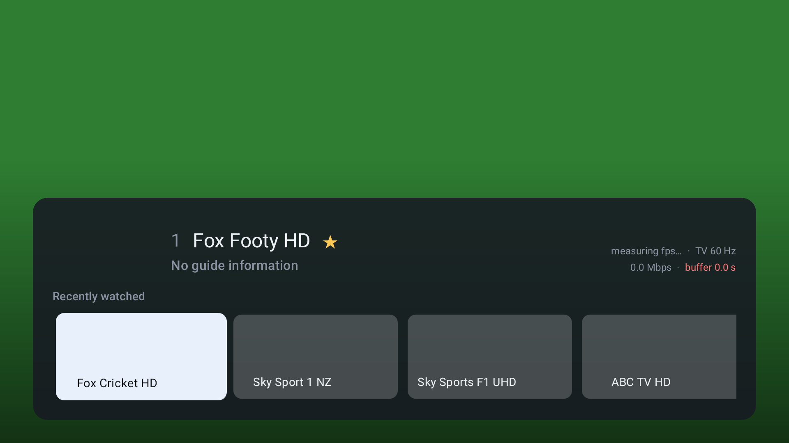

The info bar shows the channel, what's on (when your provider supplies a guide), and the picture details:
- **4K / 1080 · HEVC · HDR10 / Dolby Vision / HLG**
- **50 fps · TV 50 Hz**: the channel's frame rate and what the TV is set to (they should match)
- **Mbps · buffer**: your connection. The buffer turns red under 2 seconds.
- **Audio format** (e.g. Dolby Digital 5.1, AAC stereo)

### Typing (Search, Filter, Passphrase)
Text boxes are buttons until you press **OK**, which opens the keyboard. The keyboard's search/done key, **Back**, **⬆** or **⬇** close it again.

---

## 5. Settings

| Setting | What it does |
|---|---|
| **Profile** | Switch provider, edit a login, or add another Xtream Codes account or M3U playlist (see below) |
| **Colour** | Graphite grey, Midnight blue, Pitch green or Aurora violet |
| **Match frame rate** | Switches the TV to suit each channel (23.976, 24, 50, 59.94 or 60 Hz). Also needs the device setting from section 2 |
| **Stream format** | MPEG-TS (fastest) or HLS. Try HLS if a channel won't play (Xtream only) |
| **Buffer size** | Small (quickest channel changes), Normal, or Large (rides out a shaky connection). Takes effect straight away |
| **Test connection** | Checks your internet and your provider's server, and says which one is the problem |
| **Volume boost** | Off / +3 / +6 / +9 / +12 dB for quiet channels, with a limiter. Works on audio the device decodes itself (AAC, MP2). Dolby audio sent straight to a soundbar or AV receiver isn't changed |
| **Channel order** | Provider order or A–Z |
| **Choose groups** | Same as the Groups button (› inside a group picks its channels) |
| **Open last channel on start** | Start straight into what you were watching |
| **Backup & restore** | See below |
| **Exit Tuned** | Close the app |

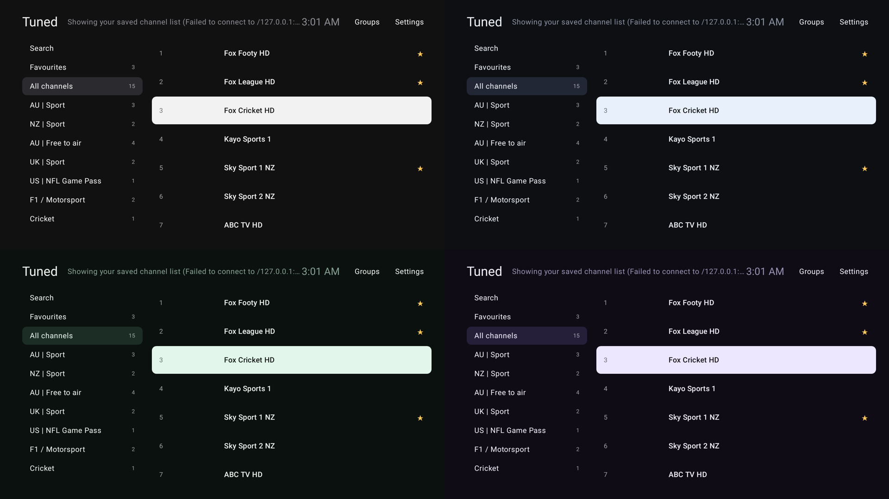

### Profiles
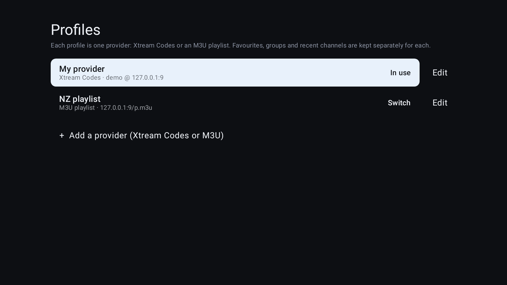

Each profile is one provider: an **Xtream Codes** login or an **M3U playlist** link. Favourites, chosen groups and channels, and recent channels are kept separately for each profile. Settings → Profile → OK on a profile switches to it; **Edit** changes the login or deletes it; **+ Add a provider** adds another.

M3U playlists play every channel and support groups, favourites and search. Their TV guide isn't loaded (yet). Movie and series entries in a playlist are skipped.

### When the picture stops (buffering)
While a channel is stuck, a panel shows **Buffering…** with how much data is arriving and how many seconds are buffered. After 5 seconds Tuned checks what's wrong and tells you:

| Message | Meaning |
|---|---|
| **No internet connection** | The device can't reach the internet: check Wi-Fi / cable / router |
| **Your provider's server isn't responding** | Your internet is fine; the problem is on the provider's side |
| **Your account is Expired** / **Too many connections** | Reported by your provider (Xtream Codes) |
| **This stream is arriving too slowly** | Internet and provider are both fine, but this channel's source is struggling: try another channel, or a **Large** buffer |

The info bar also warns when a channel has **buffered several times in the last 10 minutes**.

### Groups
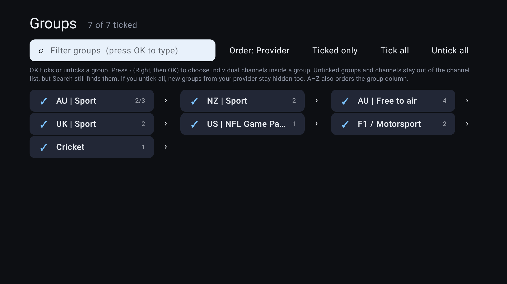

**Untick all**, then use **Filter** (e.g. "AU", "NZ", "sport", "4K") and **Order: A–Z** to find and tick the groups you use. **Ticked only** shows just your picks. Search still finds channels in unticked groups.

#### Channels inside a group
Each group has a **›** button (press ➡ from the group, then OK). Inside, the same tools work on channels:

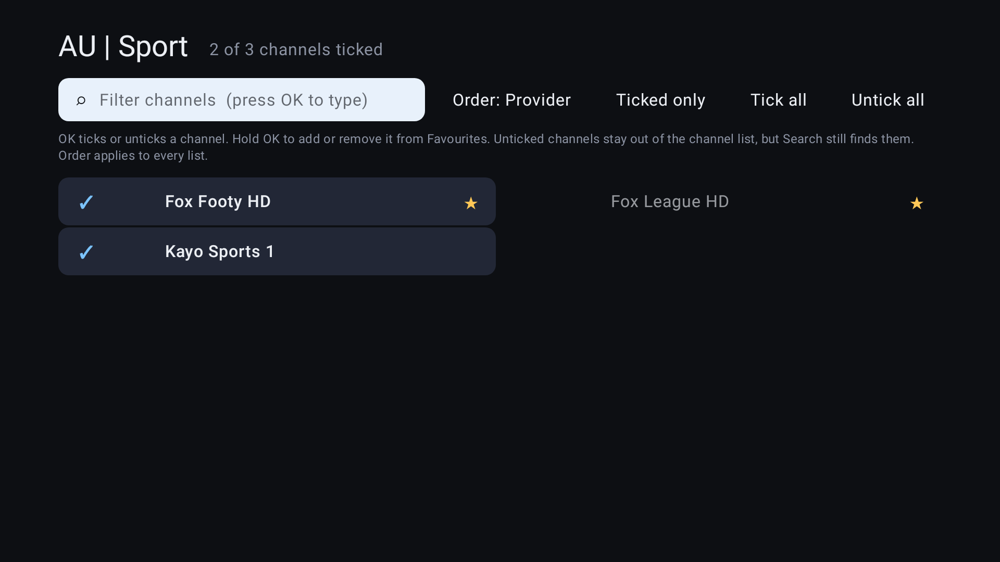

| Button | What it does |
|---|---|
| **OK** | Tick / untick the channel. Unticked channels leave the channel list (Search still finds them) |
| **Hold OK** | Add to / remove from ★ Favourites |
| **Filter**, **Order**, **Ticked only**, **Tick all**, **Untick all** | As on the Groups screen, for this group's channels |

Ticking a channel in an unticked group shows the group again, with just your ticked channels. A group whose channels are all unticked disappears from the list.

---

## 6. Phone remote

**Tuned Remote** is a companion app for your Android phone or tablet (made on a Galaxy S25 and Galaxy Tab S9 FE). It shows the TV's channel list with what's on now and next, and **tapping a channel changes it on the TV**.

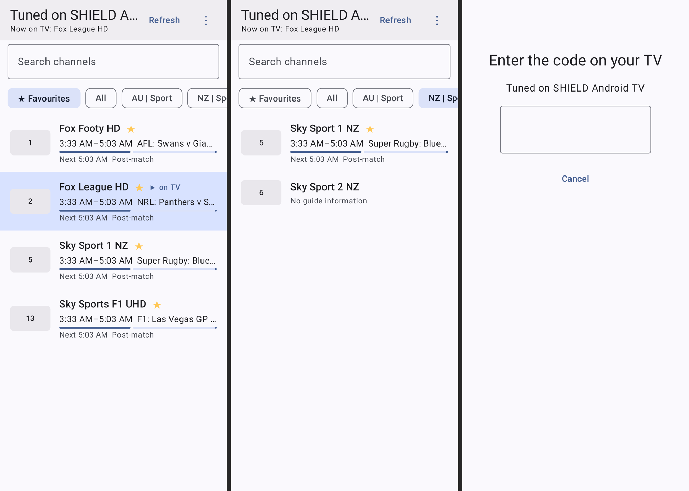

1. On the phone, open the [Tuned Remote download](https://raw.githubusercontent.com/andrewf13/Tuned/main/releases/tuned-remote-latest.apk) and install it (allow your browser to install apps when asked).
2. Open **Tuned on the TV**. The phone and TV must be on the same Wi-Fi.
3. Open **Tuned Remote**: the TV appears in the list. Tap it.
4. A **4-digit code** appears on the TV. Type it on the phone. Done: the phone remembers the TV.

| On the phone | What it does |
|---|---|
| **★ Favourites / All / group chips** | Show the same lists as the TV |
| **Search** | Find any channel in the TV's list |
| **Tap a channel** | Changes channel on the TV (it goes full screen) |
| Top bar | What's on the TV right now |
| ⋮ → **Appearance** | System, Light or Dark (Light/Dark override the phone's setting; colours follow your wallpaper on Android 12+) |
| ⋮ → **Forget this TV** | Unpair |

**Home-screen widget.** Long-press your home screen → Widgets → **Tuned Remote** → *Tuned channels*. It lists your favourites; **tap one and the TV changes channel**, without opening the app. The top line shows what's on the TV; ↻ refreshes it. Make the widget taller to show more favourites. It follows the phone's light/dark mode.

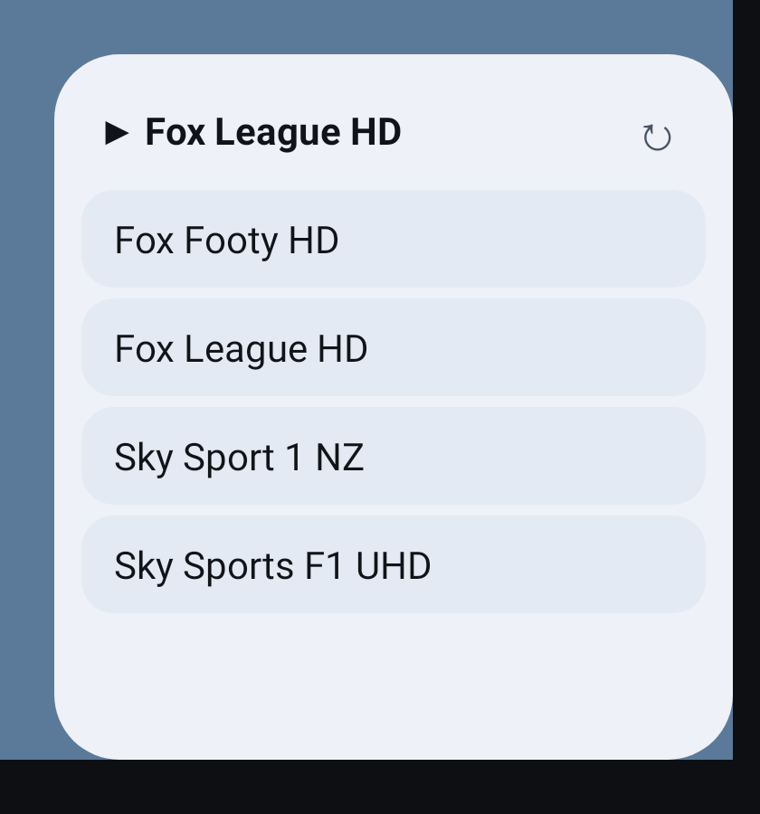

**Tablets.** On a tablet (or a phone in landscape with a wide screen) the app shows the groups down the side and channels as a grid of cards:

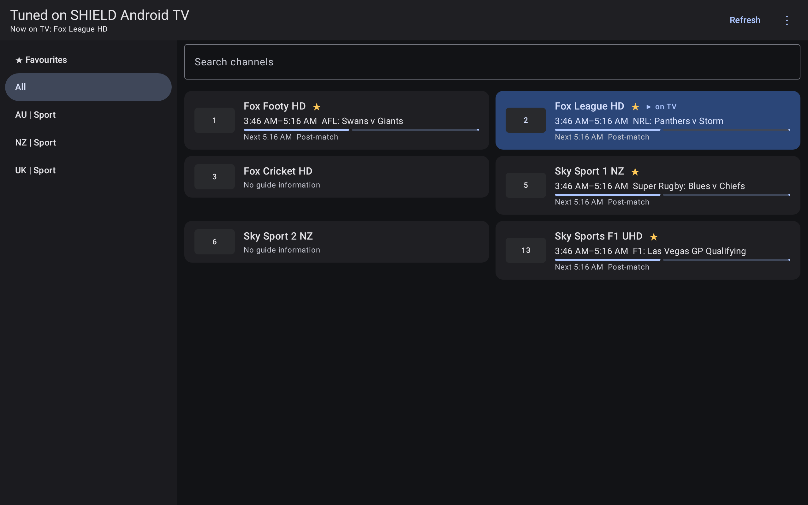

- The phone works while **Tuned is open on the TV**. If the TV is on its home screen, open Tuned first.
- The phone never receives your provider login, only channel names, logos and the guide. Only phones that entered a code on the TV can change channels.
- To unpair every phone: TV → Settings → **Phone remote** → OK twice.
- Not found automatically (some routers block discovery)? TV → Settings → Phone remote shows an address like `192.168.1.20:8642`: type it into the phone.
- The guide on the phone is the same as on the TV: if your provider doesn't send guide data, it says "No guide information".

### Sports guide (in Tuned Remote)
The **Sports** tab finds your sports in the TV guide, shows **which channels they're on**, and **tapping a channel changes it on the TV**. No account or subscription needed.

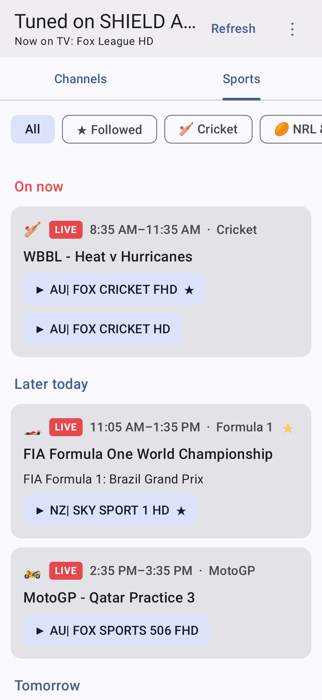

1. Open Tuned Remote → **Sports** → **⚙ Sports**.
2. Pick your **sports**: cricket, AFL, NRL & rugby league, rugby union, Formula 1, MotoGP, rally, NFL, football, tennis, golf and more.
3. Optionally add teams or events to **follow** (e.g. *Swans, All Blacks, Big Bash*): they get a ★ and their own **★ Followed** filter.
4. **Show replays & highlights** is off by default, so you see live coverage and new matches, not last week's game at 3 AM.

Each match shows **LIVE** when the guide says it's live, the time, and every channel showing it (your favourites first). **Tap a channel** and the TV switches to it.

**When the TV is off**, the phone shows the sports guide it saved last time (with a note saying so), so you can still check when the cricket starts. Turn the TV on and open Tuned (e.g. with a Google Assistant routine) to watch.

On a tablet the matches fill the screen as cards:

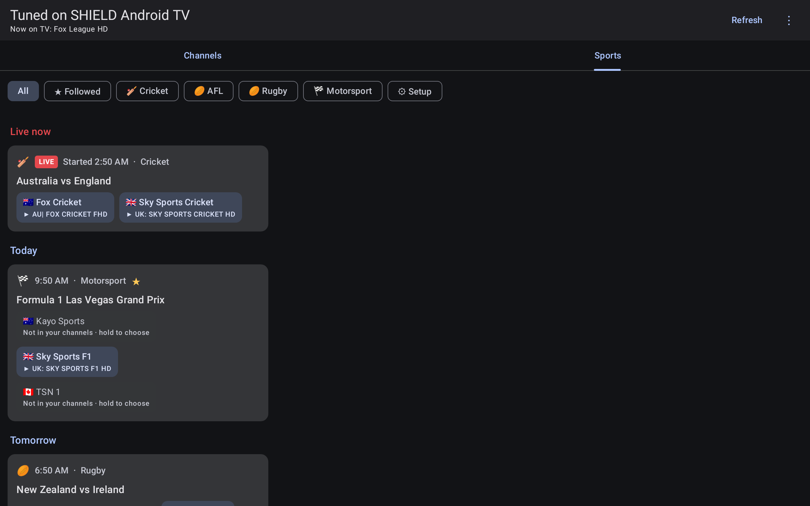

## 6a. TV guide
Tuned builds its TV guide from layered sources (TV: **Settings → TV guide**):

1. **Your provider's guide** (Xtream Codes `xmltv.php`), matched exactly by the provider's guide ids.
2. **Free community guides from [epgshare01](https://epgshare01.online/epgshare01/)** for the countries you tick (Australia and New Zealand by default; also UK, Canada, US, Ireland, South Africa, India). These fill in channels your provider's guide misses, such as Fox Cricket, Fox Footy, Fox League, Fox Sports 503–506, ESPN, beIN, and Sky Sport 1–9 NZ. They're matched to your channels by name (e.g. "Fox Cricket" → `AU| FOX CRICKET FHD`), and a channel from a different country is never used.

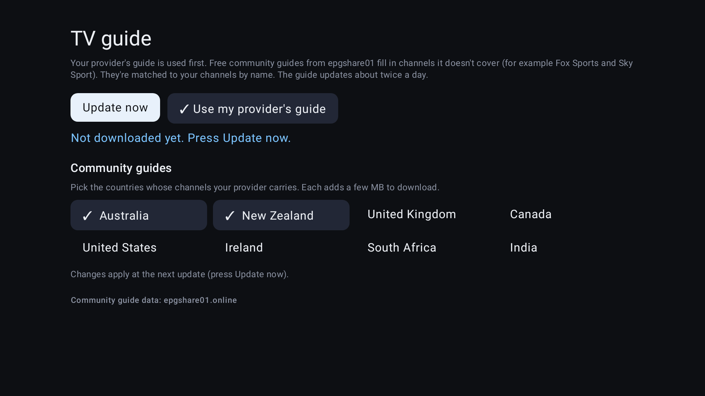

- The guide updates in the background about **twice a day**; **Update now** refreshes it immediately.
- It powers *what's on* in the TV's channel list and info bar, the phone's guide, and the Sports tab.
- To stay small (even with tens of thousands of channels), the full guide is kept for the channels in your list and favourites; for every other channel only sport is kept, so the Sports tab can still find a match on a channel you've hidden.
- The screen shows how much of your list it covers, e.g. *Guide for 412 of 450 channels in your list*.

## 7. Backup & restore

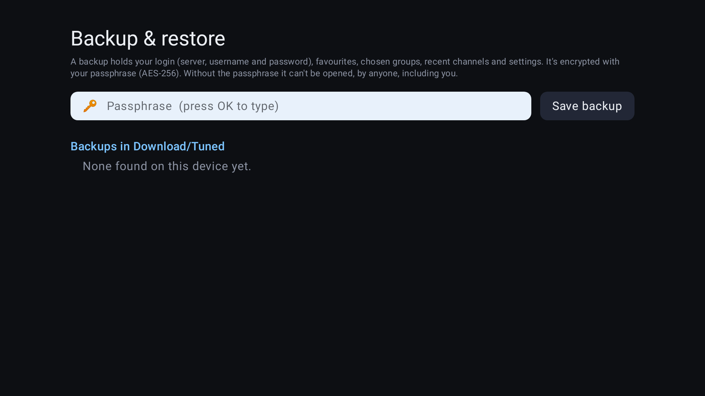

A backup holds **every profile** (logins and playlist links) with each one's **favourites, chosen groups and channels and recent channels**, plus your **settings**, in one file encrypted with a passphrase you choose (AES-256, key derived with PBKDF2).

- **Save:** Settings → Backup & restore → enter a passphrase (6+ characters) → **Save backup**. It goes to **Download/Tuned** on the device.
- **Restore:** same screen (or **Restore from a backup instead** at sign-in) → enter the passphrase → pick the backup → press OK twice.
- **Forget the passphrase and the backup can't be opened.** There's no recovery, by design.
- To move to another device, copy the `.tunedbak` file across (file manager, USB stick or cloud drive). If the device has a file picker, **Choose a file…** appears. On Android 12 and older, **Find older backups** lists backups made before a reinstall.

---

## 8. Troubleshooting

| Problem | Try |
|---|---|
| Picture keeps stopping | Read the buffering panel: it says whether it's your internet, the provider or the channel. Settings → Buffer size → Large helps on a shaky connection |
| A channel shows an error | Some channels are simply offline. Otherwise Settings → Stream format → HLS |
| "Refused" errors on every channel | Your provider's connection limit: close the app on other devices |
| TV doesn't switch refresh rate | Check the device setting in section 2. Info bar should show `50 fps · TV 50 Hz` |
| Picture isn't HDR | Use a 4K HDR channel and check your TV's input supports HDR (e.g. Sony "Enhanced format") |
| Quiet channel | Settings → Volume boost |
| Phone can't find the TV | Tuned must be open on the TV, same Wi-Fi. Or type the address from TV Settings → Phone remote |
| No "what's on" text | TV → Settings → TV guide: tick the countries your channels are from and press Update now |

---

## 9. Tuned on phones & tablets

A standalone version of Tuned for Android phones and tablets (made on a Galaxy S25 and Galaxy Tab S9 FE). It's the same engine as the TV app: Xtream Codes and M3U, profiles, favourites, groups, the TV guide and the Sports tab. **The backup format is the same too**: save a backup on the TV, copy the `.tunedbak` file to your phone, and restore it to get your providers, favourites and groups.

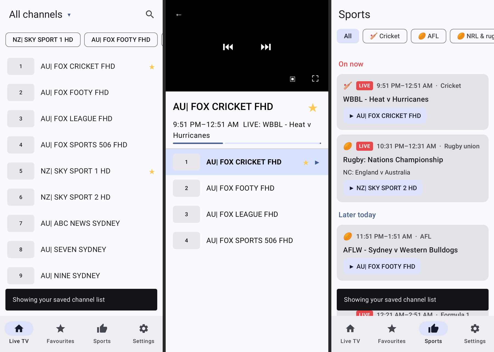

**Watching**
| Where | What |
|---|---|
| Portrait | Video on top, what's on now/next below, and the channel list underneath: tap to switch |
| Rotate to landscape (or tap ⛶) | Full screen |
| Full screen: **far left** | **Brightness** slider (or drag up/down anywhere on the left) |
| Full screen: **far right** | **Volume** slider (or drag up/down anywhere on the right) |
| Full screen: swipe left / right in the middle | Next / previous channel |
| Full screen: tap | Show or hide the controls: channel, what's on, time, ★, picture-in-picture, Fit/Zoom/Stretch, **Channels** list |
| ▣ or leave the app while watching | **Picture-in-picture**: keeps playing in a small window (automatic on Android 12+) |
| Long-press any channel | Add to / remove from ★ Favourites |

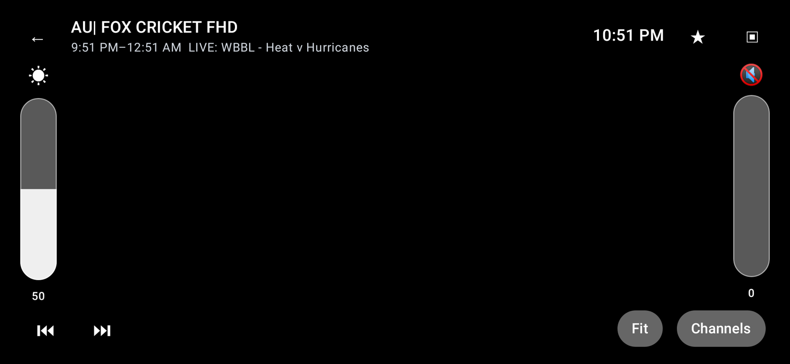

**Tabs:** Live TV (tap the title to pick a group, with a filter for long group lists, and 🔍 to search every channel), Favourites, Sports (straight from the guide, no TV needed), Settings (providers, light/dark/system, channel order, groups, buffer, volume boost, TV guide countries, backup & restore).

On a tablet, groups sit down the side and channels fill the screen; in landscape the player shows the channel list beside the video.

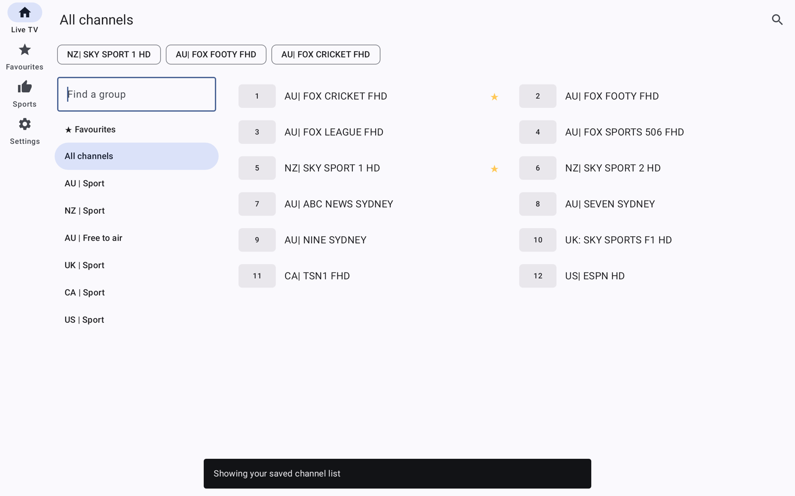

TV-only features don't apply on phones: refresh-rate switching and the phone-remote server.

## Licence
Tuned is open source under the [Apache License 2.0](LICENSE): you can use, change and share it, including commercially, as long as you keep the licence and copyright notices. See [`NOTICE`](NOTICE) for the open-source libraries it's built with.

*For building from source, see [`android/README.md`](android/README.md).*
